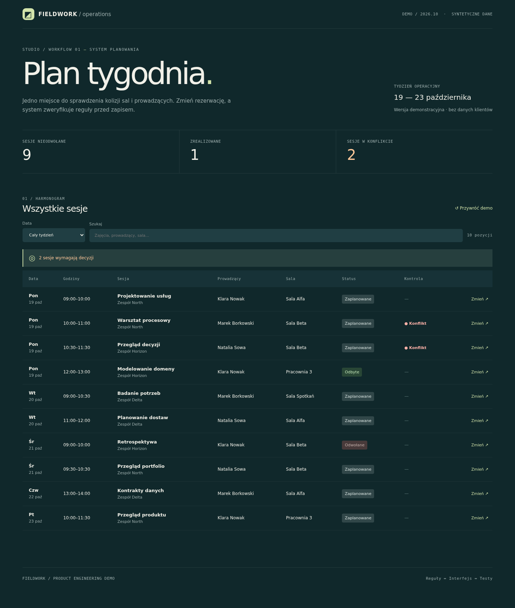

# Operations Workbench

**An interactive, deliberately small operational UI that prevents room and facilitator conflicts before accepting a change.**

[](#run-locally)

Everything is fictional. The sample has ten workshops, one intentional room collision and a dialog for moving or cancelling a session. The table is compact; there is no permanent inspector side panel. The rules live in a pure, separately tested module.



## Run locally

```sh
python3 -m http.server 8000
# visit http://localhost:8000
node --test tests/*.test.mjs
```

Node 20+ is used **only for tests**; no dependencies, bundler, backend, accounts or APIs. The browser requires JavaScript modules and HTTP (opening `file://` may fail because of CORS for module imports).

**Optional Chromium smoke (not HTTP/Pages verification):** install `playwright` for Python and Chromium, then run `python tests/browser_smoke.py`. It checks 320/390/768/1440 px, edits, rejected conflicts, filters and reset using local source modules inlined into a browser document.

## Try the interaction

1. Find the two Monday sessions marked **Konflikt**; they overlap in `Sala Beta`.
2. Choose **Zmień** on `Przegląd decyzji` and assign `Sala Spotkań`.
3. The conflict disappears. Try moving another session into an occupied room; a validation error prevents the change.
4. Use search, date filter or reset. Reloading the page resets the synthetic dataset.

## Invariants demonstrated

- An active session conflicts with another active session when **same date**, **overlapping half-open time interval**, and **same room or facilitator**.
- Cancelled sessions do not reserve resources.
- Editing affects only room or status (no hidden changes to dates/facilitators).
- Every proposed change is validated against the full unfiltered schedule.
- Updates are immutable in memory; the demo explicitly makes **no persistence claim**.

## Evidence-backed case study

[Problem, alternatives, experiments and limits](docs/CASE-STUDY.md).

## Structure

- `src/domain.mjs` — independent domain checks, not tied to the UI framework.
- `src/data.mjs` — original synthetic dataset.
- `src/app.mjs` — DOM renderer and interaction orchestration.
- `src/styles.css` — bespoke responsive visual design.
- `tests/domain.test.mjs` — edge cases and conflict regression tests.
- `docs/DECISIONS.md` — modeling and UI trade-offs.

## Deploy

GitHub Pages can serve this static repository after choosing **GitHub Actions** as the Pages build source. A workflow is included; it runs unit tests before publishing only `index.html` and `src/` to Pages. Verify functionality on the published URL; local tests do not guarantee production health.

This is a **portfolio demo, not operational scheduling software**. No authentication, persistent storage, timezone/recurrence handling, optimistic concurrency, accessibility audit, or end-to-end browser test suite is claimed. A production scheduler would need them.
